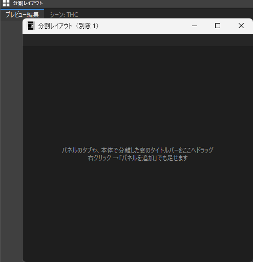

# SplitLayout_H マニュアル

**SplitLayout_H（分割レイアウト）** は、AviUtl2のパネルを、
縦横に好きなだけ分割した枠へ並べる汎用プラグインです。
本体の「左・右・上・下・中央」の 5 エリアに縛られずに配置を組めます。
パネルはドラッグで動かし、タブにまとめ、区画を一時的に広げ、配置に名前を付けて切り替えられます。
本体の外の別窓にも同じように並べられます。
プロジェクトを書き換えることはありません。

- **バージョン:** 0.3.5
- **作者:** by HexBrowns
- **動作を確かめた版:** AviUtl2 **2.1.13**

---

## しくみ（最初に知っておくこと）

本体のパネルは、本体のメイン窓が直接描いているので、そのままでは取り出せません。
**本体の「ウィンドウを分離」で独立した窓にしたパネルを、このプラグインの枠にはめ込む**しくみです。

- 並べたいパネルは、本体で**1 回だけ**分離します。次からは必要ありません
- 起動すると、前回の配置どおりに自動ではめ込みます
- 終了するときは本体の分離した窓に戻してから終わるので、本体の設定ファイル `aviutl2.ini` は壊れません
- このプラグインを外すと、パネルは本体の分離した窓として残ります

## 導入

1. [Releases](https://github.com/HexBrowns/SplitLayout_H/releases) から `HexBrowns.SplitLayout_H-v0.3.5.au2pkg.zip` をダウンロードし、AviUtl2のプレビューへドラッグ&ドロップする。
   手で置く場合は、中の `Plugin` フォルダをAviUtl2のデータフォルダへコピーする。
2. AviUtl2を再起動する。

導入されるのは `Plugin\SplitLayout_H\SplitLayout_H.aux2` だけです。

**ドッキング配置（DockLayout）とは同時に使わないでください。**
どちらも本体の窓のドラッグを受け持つので、掴んだときに両方が反応します。
入っているとログに警告が出ます。

---

## はじめの準備

1. **表示** メニュー → **分割レイアウト** で枠を出す。
2. 枠を右クリック → **ウィンドウ配置** → **中央エリア** に置く。ほかのエリアを空けておくと、画面いっぱいに使えます。
3. 並べたいパネルを、そのパネルの右クリック → **ウィンドウ配置** → **ウィンドウを分離** で分離する。
4. 分離した窓の**タイトルバー**を掴んで、枠の上へ運ぶ。出てきたガイドの上で離すと入る（下の「ガイド」）。

シーンリストなどのタイトルバーの無いパネルは、枠の右クリック → **パネルを追加** から入れます。

## 操作

| 操作 | 結果 |
|---|---|
| 分離した窓のタイトルバーを枠の上へ運ぶ | ガイドが出る。ガイドの上で離すと、その位置に入る |
| 見出しのタブを掴んで動かす | 同じ見出しの中で左右に動かすと**並べ替え**。見出しの外へ出すとガイドが出て、ほかの区画へ動かせる |
| タブを枠の外で離す | その区画から外れ、本体の分離した窓に戻る。離した所に出る |
| タブをクリック | そのパネルを前に出す。キーボードの焦点もそのパネルへ移る |
| 分離した窓を、灰色のタブが前に出ている区画の中央へ落とす | 本体のパネルなら、その灰色のタブとして入る。一度別の名前のタブになってしまったパネルを戻すのに使う |
| 区切りをドラッグ | 区画の大きさを変える。区切りに接している区画だけが変わり、ほかの区画の幅は保たれる |
| 見出しをダブルクリック | その区画を枠いっぱいに広げる／戻す |
| ドラッグ中にEsc | 取り消す |

### ガイド

ドラッグ中、カーソルの下の区画の中央に 5 つ、枠の四辺に 4 つのガイドが出ます。

| ガイド | 落としたときの結果 |
|---|---|
| 区画の中央 | その区画のタブにまとめる |
| 区画の上下左右 | その区画を半分に分けて、その側に入れる |
| 枠の四辺 | 枠全体を分けて、その側に細めに入れる |

ガイドの上にいる間は、入る範囲が青く出ます。
ガイドの外で離すと何もしません。

## 右クリックメニュー

枠の見出しや空いた区画を右クリックすると出ます。

| 項目 | 内容 |
|---|---|
| パネルを追加 | 分離していて、まだどの枠にも無いパネルの一覧。選ぶと、右クリックした区画のタブに入る |
| 「〈名前〉」を外す | 前に出ているタブを外し、本体の分離した窓に戻す |
| この区画を広げる／元に戻す | 見出しのダブルクリックと同じ |
| 配置 → 名前を付けて保存… | 別窓も含めた今の配置に、名前を付けて保存する |
| 配置 → 〈保存した名前〉 | その配置に切り替える。新しい配置に無いパネルは、本体の分離した窓に戻る |
| 配置 → 今の配置で上書き／削除 | 保存した配置を上書き・削除する |
| 別窓を開く | 本体の外に、同じように分割できる窓を開く |
| 使い方 | 短い説明を出す |

### 配置の切り替えをショートカットにする

**編集** メニュー → **分割レイアウト** → **配置 1 に切り替え** 〜 **配置 5 に切り替え** があります。
保存した順の先頭 5 つに切り替えます。
本体の **設定** → **ショートカットキーの設定** でキーを当てられます。
**別窓を開く** もあります。

## 別窓

右クリック → **別窓を開く** で、本体の外に枠を 1 枚開きます。
サブモニターへ動かして使えます。
何枚でも開けます。

- 中の操作は主の枠と同じです
- タスクバーにボタンが出ます。最小化するとタスクバーに入ります。本体を最小化すると一緒に隠れます
- 位置と大きさは配置に含まれ、次の起動で戻ります
- **×** で閉じると、中のパネルは本体の分離した窓に戻り、配置から別窓が消えます

## タブの見え方

| タブ | 意味 |
|---|---|
| 白い文字 | 前に出ているパネル。名前はパネルの今の題。色設定なら「テキスト [文字色]」のように、編集する対象で変わる |
| 薄い文字 | 裏のタブ |
| 灰色の文字 | パネルが分離されていない・閉じられている。区画には「本体で『ウィンドウを分離』すると、ここに入ります」などが出る。分離し直すと自動で入る。不要であれば「外す」 |

本体の「表示」メニューでパネルを消すと、タブは残って区画に「非表示です」と出ます。
表示し直すと同じ所に戻ります。

### 本体がパネルを開いたとき

本体が裏のタブのパネルを開こうとしたときは、そのタブを前に出します。
オブジェクト設定の **色を編集** で色設定を開いたときなどです。
本体がいくつものパネルをまとめて並べ直したときは、タブは動かしません。

### 題の変わるパネル

色設定やシーンのプレビューは、編集する対象や表示中のシーンで題が変わります。
それでも同じタブに入れたままにします。

プラグインのウィンドウは、AviUtl2の言語を切り替えると題が変わることがあります（English にすると「色空間ピッカー」が「Color Space Picker」になるなど）。
v0.3.5 から、言語を切り替えて再起動しても同じタブに入ります。
以前の版で別の名前のタブができてしまっていたら、その灰色のタブは、次にパネルが入ったときに自動で外れます。

起動して少しすると、前に出ているタブが灰色で、同じ区画にパネルの入ったタブがあれば、近いほうのタブを前に出します。
パネルが裏に回ったまま見えなくなるのを防ぐためです。

### シーンのプレビュー

シーンのプレビューは、窓の題が表示中のシーン名になるので、タブには **シーン: 〈シーン名〉** と出ます。
別のシーンのプロジェクトを開いても、同じタブに入ったままです。

## 空白キーの再生について

プレビュー編集の右クリックにある **ショートカットキー操作の再生はシーン再生を優先** がオンのときは、
シーンのプレビューを開いている間、空白キーなどのショートカットはシーンのプレビューのほうを再生します。
裏のタブにしていても同じです。
プレビュー編集を空白キーで再生したいときは、この設定を外すか、シーンのプレビューを使わない間は「表示」メニューで消してください。

## 設定ファイル

今の配置と名前を付けた配置は、`<データフォルダ>\Plugin\SplitLayout_H\layouts.json` に保存されます。
読めなかったときは `layouts.json.broken` に退避して、空の配置で始めます。

プラグインの中で思わぬ誤りが起きたときは、本体を止めずにその処理を飛ばし、`<データフォルダ>\Plugin\SplitLayout_H\panic.log` に場所を書きます。
このファイルがあれば、作者に知らせてください。

## 注意事項・制限

- 本体の窓の作りに依っているので、本体の更新で動かなくなることがあります。そのときもパネルは本体の分離した窓として残り、プロジェクトには影響しません
- 本体のエリアに置いたままのパネルは、こちらから分離できません。本体で 1 回分離してください
- シーンリストなどのタイトルバーの無いパネルは、ドラッグでは入れられません。右クリック → **パネルを追加** を使います
- 主の枠を本体の「表示」で消すと、中のパネルは本体の分離した窓に戻ります。出し直すと、また入ります
